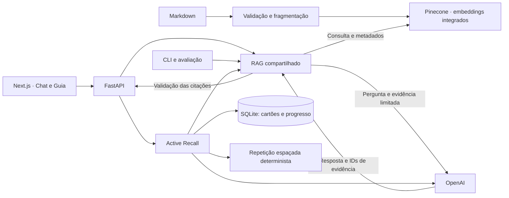
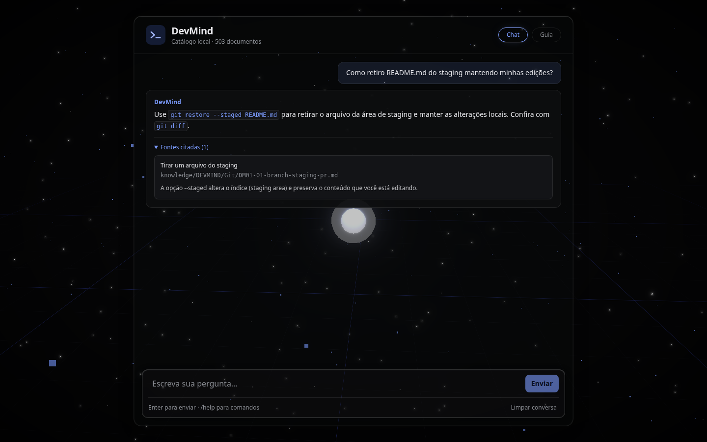
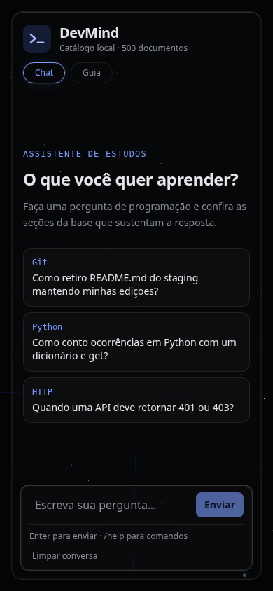

# DevMind

DevMind é um assistente de estudos de programação. Em vez de procurar manualmente em várias anotações, você faz uma pergunta em linguagem natural e recebe uma explicação com o arquivo, a seção e um trecho de cada fonte citada. Quando a base não sustenta uma resposta, o chat sinaliza a falta de evidência.

O modo **Estudo** transforma documentos recuperados em flashcards com IA. Você responde com suas palavras, confere feedback e fontes, indica como foi recordar e acompanha a próxima revisão. Cartões, tentativas, calendário e sessões diárias ficam em SQLite. É uma demo local de um estudante. [Active Recall: arquitetura, endpoints e demonstração](docs/ACTIVE_RECALL.md)

## O que você pode fazer

- Conversar com o assistente em um chat responsivo, testar perguntas sugeridas e limpar o histórico da sessão.
- Expandir as fontes para conferir o caminho, a seção e o trecho do Markdown.
- Navegar pelo Guia e restringir uma pergunta a um módulo, tema ou documento.
- Indexar arquivos Markdown em lotes e atualizar a base sem multiplicar os mesmos fragmentos.
- Medir recuperação, abstensão, atribuição de fontes, latência e erros com o mesmo pipeline do chat.
- Gerar até três cartões por tema ou documento, praticar até cinco cartões na sessão diária e acompanhar progresso por tema.
- Retomar respostas após falhas de provedor e ajustar a avaliação automática com sua própria percepção de recordação.

## Arquitetura



Python 3.12, FastAPI, Pinecone com `llama-text-embed-v2`, OpenAI Chat Completions, pytest, Next.js, React, TypeScript e Tailwind CSS. A visualização em Three.js é decorativa.

## Executar localmente

Instale Python 3.12, uv e Node.js 20.9 ou superior. A verificação usou Node.js 20.20.2. Execute da raiz do repositório. [Instalação do uv](https://docs.astral.sh/uv/getting-started/installation/)

```bash
uv venv --python 3.12 .venv
uv pip install -p .venv/bin/python -r requirements.txt
npm --prefix frontend ci
.venv/bin/python ingest.py --module devmind --dry-run
```

Para usar o chat com provedores reais, copie `.env.example` para `.env` se ainda não existir. Preencha `PINECONE_API_KEY` e `OPENAI_API_KEY` no arquivo local. Configure `PINECONE_NAMESPACE=devmind-portfolio` para isolar a demonstração. Use o mesmo namespace em ingestão, API, CLI e avaliação.

Com autorização para consumo no projeto dos provedores, execute os comandos abaixo. `main.py` verifica o índice e cria um índice serverless se ele ainda não existir. Você pode pular esse comando quando já houver um índice compatível.

```bash
.venv/bin/python main.py
.venv/bin/python ingest.py --module devmind
.venv/bin/python -m uvicorn api:app --host 127.0.0.1 --port 8000 --no-proxy-headers
```

Em outro terminal, execute `npm --prefix frontend run dev` e abra [localhost:3035](http://localhost:3035). A URL padrão do backend é `http://localhost:8000`. Para alterá-la, use `NEXT_PUBLIC_API_URL` em `frontend/.env.local`. Reinicie o servidor após alterar a configuração. Para a demo de produção, use os comandos verificados abaixo.

```bash
npm --prefix frontend run build -- --webpack
npm --prefix frontend run start -- --hostname 127.0.0.1 --port 3035
```

Sem credenciais, os mesmos servidores permitem abrir a interface, consultar `/health`, `/stats` e navegar no Guia. A ação de perguntar retorna uma mensagem de configuração. Para uma consulta pelo terminal, use `.venv/bin/python search.py --debug`.

No modo **Estudo**, selecione **Guias DevMind → Git**, quantidade **1** e o foco “Como retirar README.md do staging mantendo as edições?”. Gere, responda, avalie e selecione **Lembrei**. O painel **Progresso** mostra a próxima revisão. A base privada é criada automaticamente em `data/learning.sqlite3`; preserve esse diretório entre execuções. [Roteiro completo e recuperação após falhas](docs/ACTIVE_RECALL.md#executar-e-demonstrar)

### Configuração do backend

| Variável | Padrão | Função |
| --- | --- | --- |
| `PINECONE_INDEX_NAME` | `kenzie-knowledge` | Índice integrado com mapeamento `text → chunk_text`. |
| `PINECONE_NAMESPACE` | `devmind` | Partição consultada e atualizada pelo app. |
| `RAG_TOP_K` | `3` | Número máximo de candidatos para o contexto, de 1 a 20. |
| `RAG_SCORE_THRESHOLD` | `0.40` | Limiar inicial de similaridade. Use o conjunto de avaliação para calibrá-lo. |
| `RAG_MODEL` | `gpt-4o` | Modelo Chat Completions com suporte a JSON Schema estrito. |
| `RAG_TEMPERATURE` | Omitida | Valor entre 0 e 2. Defina somente para modelos que aceitam o parâmetro. |
| `RAG_CONTEXT_CHARS` | `10000` | Limite em caracteres do JSON de evidências. |
| `RAG_TIMEOUT_SECONDS` | `15` | Timeout por operação nos SDKs. |
| `FRONTEND_ORIGIN` | localhost e 127.0.0.1 na porta 3035 | Origens CORS, separadas por vírgulas. |
| `LEARNING_DB_PATH` | `data/learning.sqlite3` | Progresso privado do estudante local, com migração automática. |

`/ask` e `/learning/*` exigem peer local, Host local e Origin autorizado. Há cotas persistentes de 50 perguntas de chat, 10 gerações e 50 avaliações por dia de São Paulo. Falhas contam na cota. Não publique a demo por proxy ou túnel: esses controles não são autenticação multiusuário.

### Atualizar a base

Adicione Markdown UTF-8 em `knowledge/<MÓDULO>/<TEMA>/`, com título e seções `##`. O índice recebe o caminho relativo, a seção e o número de fragmento. Um upsert substitui registros com os mesmos IDs. Para eliminar fragmentos de documentos removidos ou encurtados, execute `.venv/bin/python ingest.py --module devmind --prune`. O comando envia todos os lotes antes de apagar IDs obsoletos do módulo. Aguarde a atualização do índice antes de consultar e execute uma ingestão por vez em cada namespace. [Consistência de dados no Pinecone](https://docs.pinecone.io/guides/data/check-data-freshness)

O módulo `knowledge/DEVMIND` contém exemplos autorais com referências primárias. O catálogo local inclui também o corpus herdado. Confirme a licença e a procedência desse conteúdo antes de incluí-lo em uma distribuição pública. Ao migrar de uma carga antiga, faça o primeiro upsert em um namespace novo para evitar misturar IDs e caminhos antigos.

### Roteiro para a demo

| Pergunta | O que conferir |
| --- | --- |
| Como retiro README.md do staging mantendo minhas edições? | Citação de Git e preservação das alterações locais. |
| Como conto ocorrências em Python com um dicionário e get? | Citação de Python e valor padrão de uma chave ausente. |
| Por que repetir um PUT pode ser seguro e repetir um POST pode duplicar pedidos? | Citação de HTTP e distinção entre os efeitos pretendidos. |
| Qual deles devo usar no meu projeto? | Abstensão ou pedido de especificação pela falta de contexto. |
| Qual é a receita de uma pizza margherita? | Abstensão por falta de evidência. |

## Interface

As capturas mostram o build local. A resposta de Git exibida no desktop usa um provedor simulado.





## Verificação e avaliação

```bash
.venv/bin/python -m pytest tests/ -q
.venv/bin/python evaluation/evaluate.py
.venv/bin/python evaluation/validate_learning.py
npm --prefix frontend run lint
(cd frontend && npx tsc --noEmit)
npm --prefix frontend run build -- --webpack
```

A [execução simulada](evaluation/results-mock.json) verificou o comportamento do pipeline em 41 cenários. Os simuladores usam os rótulos para construir a recuperação e a geração, portanto o resultado mede a execução das regras do aplicativo. Para medir os provedores com o corpus autoral já carregado, use `.venv/bin/python evaluation/evaluate.py --live --portfolio`. O comando grava um relatório distinto com configuração e resultados por pergunta. A integração opcional e os resultados desta entrega estão no [relatório de testes](docs/TEST_REPORT.md).

## Limitações e próximos passos

O histórico do chat fica na página e cada pergunta é independente. Active Recall persiste as tentativas e a evidência de cada cartão em SQLite. A validação garante que uma citação existe no contexto enviado ao modelo. Aferir se cada afirmação é sustentada pelo trecho exige revisão humana ou uma metodologia adicional. A avaliação da IA pode falhar, e a autoavaliação do estudante tem prioridade no calendário. O catálogo local e o índice remoto têm ciclos de atualização separados. A API está restrita à demo local; exposição pública exige autenticação, autorização por recurso e cotas por usuário.

Os próximos passos são ampliar a avaliação pedagógica com respostas rotuladas por pessoas, calibrar o limiar e revisar erros de fundamentação. WhatsApp fica para uma etapa posterior; a seleção diária já é independente do canal.

[Arquitetura](docs/ARCHITECTURE.md) · [Auditoria inicial](docs/AUDIT.md) · [Decisões](docs/DECISIONS.md) · [Testes e entrega](docs/TEST_REPORT.md)

[Active Recall](docs/ACTIVE_RECALL.md) · [Evidências da entrega](docs/ACTIVE_RECALL_REPORT.md) · [Entrevista e CV AI Builder](docs/AI_BUILDER.md)
