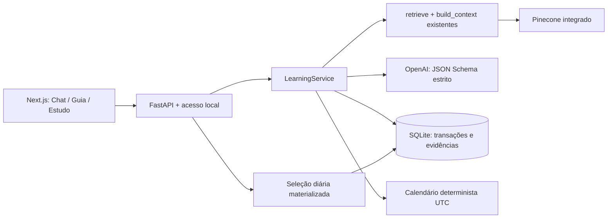

# Active Recall — MVP local

Implementado em 12/11/2026 para a demonstração DevMind. Um estudante seleciona módulo, tema ou documento do Guia, gera até três cartões com evidências do RAG, responde com suas palavras, recebe feedback e define como foi recordar. O modo **Estudo** reúne painel, prática e progresso, mantendo Chat e Guia existentes.

## Executar e demonstrar

Use o ambiente e as credenciais já descritos no [README](../README.md). Não substitua um `.env` existente. O namespace de ingestão precisa ser o mesmo da API. A base SQLite é criada e migrada na primeira operação.

```bash
.venv/bin/python ingest.py --module devmind --dry-run
# A próxima operação usa Pinecone real:
.venv/bin/python ingest.py --module devmind
.venv/bin/python -m uvicorn api:app --host 127.0.0.1 --port 8000 --no-proxy-headers
```

Em outro terminal:

```bash
npm --prefix frontend run dev
```

Abra http://localhost:3035, selecione **Estudo**, módulo **Guias DevMind**, tema **Git** e quantidade **1**. Use o foco “Como retirar README.md do staging mantendo as edições?”. Clique em **Gerar e estudar**, responda antes de abrir as fontes, avalie e selecione sua recordação. Confira a resposta de referência, o documento e a próxima revisão. Termine a sessão e abra **Progresso**.

Sem chaves, painel, progresso, fila e Guia continuam disponíveis. Geração requer Pinecone e OpenAI; avaliação de um cartão já salvo requer somente OpenAI. Uma falha mantém o texto no servidor e no rascunho do navegador. Reabra o cartão para reenviar a mesma resposta.

## Arquitetura final



- `learning_models.py`: entradas limitadas, saídas estruturadas e validação Pydantic estrita.
- `learning_service.py`: recuperação, geração, avaliação com rúbrica salva, validação de citações e registro de `RunTrace`.
- `learning_store.py`: migração, SQLite, cotas, reservas, cartões, tentativas, calendário e sessões diárias.
- `review_schedule.py`: função pura de intervalos; `learning_api.py`: adaptador HTTP.
- `local_access.py`: restrição de peer, Host e Origin para a demo local.
- `frontend/components/study/Study.tsx`: experiência de estudo integrada ao Terminal existente.

Nenhum serviço de WhatsApp ou scheduler foi adicionado. `LearningService` e `LearningStore.daily()` são independentes do canal. Um adaptador futuro poderá consumir os mesmos IDs e a seleção diária, com autenticação e idempotência de entrega próprias.

## Evidência e avaliação

A geração valida o escopo contra o Guia local, reaproveita os filtros, o limiar e o orçamento de contexto do RAG e faz uma única chamada de geração. Sem evidência elegível, responde 422 e não chama OpenAI. A IA pode abster-se com uma lista vazia.

As chamadas seguem o contrato de [Structured Outputs da OpenAI](https://developers.openai.com/api/docs/guides/structured-outputs), com JSON Schema estrito e validação local adicional.

Cada cartão guarda pergunta, referência, explicação, conceitos esperados, dificuldade, modelo e versão do prompt. A evidência inclui caminho, seção, ordinal, texto integral do fragmento, SHA-256, índice e namespace. O modelo devolve IDs como `S1`; o backend resolve os caminhos a partir dos resultados recuperados e rejeita IDs desconhecidos. As fontes precisam pertencer ao escopo e existir no Guia. Um conjunto com estrutura, quantidade ou perguntas normalizadas duplicadas inválidas não grava cartões parciais.

A explicação persistida é extrativa: quando a explicação proposta não é um trecho literal de uma das fontes citadas, o serviço a substitui por até 1200 caracteres da primeira evidência citada. Isso impede que uma paráfrase acrescente qualificações na explicação. Pergunta, resposta de referência, rúbrica e feedback continuam sujeitos à revisão semântica; pertencer à fonte não comprova por si só a pertinência ao exercício.

Pergunta, referência, rúbrica e evidência são imutáveis. Repetir uma pergunta com a mesma evidência reutiliza o cartão; mudar a evidência permite criar uma nova versão. A API sinaliza quando o fragmento atual do documento já difere da cópia salva. O tema é inferido das fontes quando a geração abrange o módulo inteiro e as fontes pertencem a um único tema.

Antes de responder, a API entrega pergunta, fontes e calendário, sem solução ou rúbrica. A correção usa exclusivamente a versão salva, sem nova busca. O prompt admite equivalências semânticas e diferenças de linguagem; classifica `correct`, `partial`, `incorrect` ou `ungradable`. O texto do estudante é dado não confiável, inclusive tentativas de alterar instruções. Citações inválidas, saída truncada, recusa e estrutura inválida são rejeitadas. Uma guarda conservadora também rejeita trechos entre crases que não aparecem na evidência; isso pode gerar falsos positivos e permitir nova tentativa.

Pertinência semântica não é comprovada pela validade estrutural. O modelo pode omitir matizes, produzir uma explicação imprecisa ou avaliar mal. A interface declara essa limitação, mostra a referência e a evidência e permite autoavaliação independente. Não há comparação literal entre a resposta do aluno e a referência.

## SQLite, consistência e identidade

O padrão é `data/learning.sqlite3`, configurável por `LEARNING_DB_PATH`. A pasta e os arquivos SQLite/WAL/SHM estão no `.gitignore`, fora dos arquivos públicos do Next.js. A migração [001_learning.sql](../migrations/001_learning.sql) usa `PRAGMA user_version=1`, sem apagar dados; versões futuras precisam de uma nova migração. Versões de banco mais novas são recusadas.

| Entidade | Persistência |
| --- | --- |
| `learners` | Identidade fixa `local-demo`, fuso `America/Sao_Paulo`. |
| `cards`, `card_evidence` | Cartão e versão documental imutável. |
| `operations` | Solicitações de geração/avaliação, payload, estado, lease, resultado e erro. Inclui respostas ainda não avaliadas. |
| `review_events` | Histórico de respostas, decisões da IA, autoavaliação, uso e calendário anterior. |
| `review_schedule` | Contagem, etapa, falhas de recordação, última e próxima revisão. |
| `study_sessions`, `daily_assignments` | Uma seleção diária estável, de até cinco cartões. |
| `daily_usage`, `provider_runs` | Cotas reservadas e consumo/latência/modelo medidos, inclusive saídas inválidas. |

Conexões usam foreign keys, WAL e espera máxima de cinco segundos. As transações de escrita usam `BEGIN IMMEDIATE`; chamadas externas ficam fora delas. A confirmação de um evento e de seu calendário acontece na mesma transação. Recomenda-se um processo para esta demo.

`request_id` é um UUID. A chave é estudante + tipo de operação + ID, com fingerprint dos parâmetros. Repetir uma operação concluída devolve o resultado salvo sem chamar a IA ou alterar progresso. Mudar parâmetros com o mesmo ID retorna 409. Uma reserva dura 120 segundos; um timeout marca falha e permite repetir. O token da reserva impede que um trabalhador atrasado confirme o resultado de outro. O calendário tem versão, e avaliações simultâneas do mesmo cartão são serializadas. Uma tentativa antiga não sobrescreve uma revisão posterior.

Não há garantia de cobrança externa exatamente uma vez: depois de uma resposta perdida, um reenvio pode gerar uma segunda chamada faturável. O que é protegido transacionalmente é a gravação do evento e o avanço do calendário.

Não há autenticação multiusuário. A identidade é determinada pelo servidor, sem aceitar `learner_id` arbitrário. **É uma demo local de um estudante.** Use bind em loopback e `--no-proxy-headers`; não publique por túnel ou reverse proxy. Os controles locais não equivalem a autenticação. Publicação exige identidade, autorização por objeto e cotas por usuário.

Faça backup pelo SQLite Backup API ou pare a API e preserve banco, WAL e SHM juntos. Não exclua o banco para atualizar código. Rascunhos ficam no armazenamento local do mesmo navegador; respostas submetidas também ficam no servidor.

## Calendário e prática diária

| Recordação | Efeito |
| --- | --- |
| `good` / Lembrei | Avança uma etapa: 1, 3, 7, 14 e 30 dias; teto de 30. |
| `easy` / Foi fácil | Avança duas etapas; primeiro intervalo de 3 dias. |
| `hard` / Com dificuldade | Mantém etapa e volta em 1 dia. |
| `again` / Não lembrei | Reinicia etapa, volta em 1 dia e soma uma falha de recordação. |

A classificação automática mapeia correta → good, parcial → hard e incorreta → again. `ungradable`, timeout e saídas inválidas não avançam o calendário. A autoavaliação pode substituir a decisão automática, recalculando a partir do calendário anterior do mesmo evento, sem somar duas revisões. Ela também permite agendar um resultado `ungradable`. Só a revisão mais recente pode ser autoavaliada, uma única vez; repetir a mesma autoavaliação é idempotente.

Datas são calculadas em UTC a partir da revisão, com durações de 24 horas. O dia da sessão usa São Paulo. A fila prioriza a data mais antiga e desempata por falhas de recordação e dificuldade. A sessão diária é criada sob demanda, com chave única estudante + data, e conserva a seleção mesmo após novas gerações. Se for criada vazia, continua vazia nesse dia; os novos cartões podem ser praticados pela fila ou imediatamente após gerar. O painel não cria uma sessão diária vazia ao carregar.

“Praticado” significa pelo menos uma revisão agendada, não domínio comprovado. A proporção de avaliações corretas é uma métrica do avaliador, sujeita a seus erros.

## Endpoints

As operações `/learning/*` e `/ask` são restritas à demo local. `/health`, `/stats` e Guia mantêm seus contratos.

| Método | Rota | Entrada / resultado |
| --- | --- | --- |
| POST | `/learning/cards` | `request_id`, `module`, `topic?`, `source?`, `focus?`, `count` de 1 a 3 → perguntas e fontes. |
| GET | `/learning/cards/{id}` | Pergunta, fontes, calendário e última tentativa recuperável. |
| POST | `/learning/cards/{id}/reviews` | `request_id`, `answer` de 1 a 1200 caracteres → feedback, referência, fontes e calendário. |
| POST | `/learning/reviews/{id}/recall` | `recall`: `again`, `hard`, `good` ou `easy` → autoavaliação e calendário final. |
| GET | `/learning/due?limit=5` | Fila vencida, limite de 1 a 20. |
| GET | `/learning/daily` | Seleção diária persistida e progresso da sessão. |
| GET | `/learning/progress` | Totais, pendências, próximos vencimentos, progresso por tema e cotas usadas. |

O OpenAPI completo fica em http://127.0.0.1:8000/docs. Entradas inválidas retornam 422 sem ecoar o conteúdo; recursos ausentes, 404; conflitos, 409; cota diária, 429. Falhas externas reutilizam a tradução sanitizada de `providers.py`.

Limites fixos por dia local: **10 gerações, 50 avaliações e 50 perguntas de chat**. Falhas e novas tentativas consomem cota; replay concluído não. Geração tem até 2400 tokens de saída e avaliação até 1400, uma chamada por tentativa, com os timeouts e reintentos dos clientes existentes. Os limites são contagens, não um teto monetário exato. `RunTrace` registra uso reportado pelos provedores; uso ausente não é tratado como zero medido.

## Verificação reproduzível

```bash
.venv/bin/python -m pytest tests/ -q
.venv/bin/python -m pytest tests/test_learning.py -q
.venv/bin/python evaluation/validate_learning.py
npm --prefix frontend run lint
(cd frontend && npx --no-install tsc --noEmit)
npm --prefix frontend run build -- --webpack
```

O validador usa fixtures por padrão. Para consumo real pequeno e autorizado:

```bash
.venv/bin/python evaluation/validate_learning.py --live
```

Essa execução envia somente três fragmentos do documento autoral de Git a um namespace exclusivo; gera um cartão e avalia três respostas sintéticas: equivalente, incorreta e tentativa de alterar instruções. Confere replay, autoavaliação, sessão diária e persistência após reabrir o banco. O SQLite é temporário, e somente os IDs escritos pelo validador são retirados do Pinecone. O relatório informa se a limpeza foi verificada. Não substitui uma avaliação pedagógica ampla.

O QA do navegador usa Chrome e Playwright, com uma instalação de Playwright disponível no Node. Não acrescenta dependências de produção. Em terminais separados:

```bash
.venv/bin/python evaluation/serve_learning_fixture.py --mock --port 8007
npm --prefix frontend run start -- --hostname 127.0.0.1 --port 3036
node frontend/tests/study.e2e.mjs
```

Se Playwright já estiver instalado em outro ambiente, a variável `PLAYWRIGHT_MODULE_PATH` aceita o caminho desse pacote. O teste encaminha somente as chamadas da API da página de teste ao backend de fixtures em 8007; ele não consulta provedores reais. As capturas identificam o feedback como simulado.

Resultados medidos, diferenças entre mocks e live e limitações estão no [relatório de entrega](ACTIVE_RECALL_REPORT.md). O [plano original](ACTIVE_RECALL_PLAN.md) fica preservado como registro da proposta.
