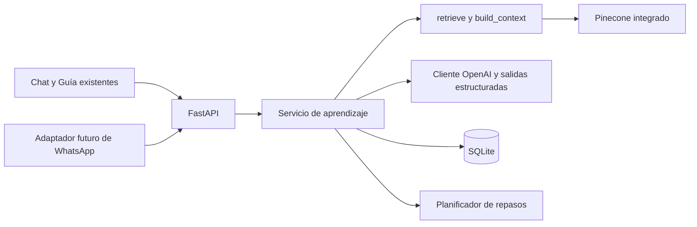

# DevMind Active Recall

> Atualização de implementação em 12/11/2026: o MVP local está implementado. Este texto original fica preservado como proposta histórica. Consulte a [arquitetura e operação atuais](ACTIVE_RECALL.md) e os [resultados e limites verificados](ACTIVE_RECALL_REPORT.md).

Propuesta del 12/11/2026, con entrega funcional prevista para el 15/11 y margen de revisión el 16/11. La validación real previa completó ingestión, recuperación, generación, citas, abstención y limpieza en un namespace aislado. Los resultados y sus límites están en el informe de evaluación. Este documento describe trabajo futuro. [Evaluación RAG](RAG_EVALUATION.md)

## Alcance mínimo

El estudiante selecciona un documento o tema del Guía, genera hasta tres tarjetas, responde una pregunta sin ver la solución y recibe una calificación con explicación y fuentes. El servidor conserva los intentos y presenta diariamente hasta cinco tarjetas pendientes. La primera entrega funciona con la API y el frontend existente. La conexión con WhatsApp queda como adaptador posterior.

Se propone una demostración de un solo estudiante, ejecutada localmente. El acceso público multiusuario requiere resolver identidad y autorización antes de abrir el servicio. El progreso se guarda en SQLite mediante `sqlite3`, disponible en Python, con migraciones SQL pequeñas y versionadas.

## Arquitectura propuesta

`learning_service.py` coordinaría generación y corrección. `learning_store.py` concentraría SQL y transacciones. `review_schedule.py` calcularía intervalos con funciones puras. FastAPI expondría las operaciones. El adaptador de canal traduciría mensajes a estas mismas operaciones y conservaría el identificador del estudiante y de la solicitud.

La recuperación reutilizaría `retrieve`, `build_scope_filter` y `build_context`. Los clientes, timeouts y traducción de errores se mantendrían en `providers.py`. La evidencia tendría los mismos campos `source`, `section` y `chunk_id`, junto con una copia íntegra del texto recuperado. La API de chat actual seguiría utilizando `answer_question`. [Pipeline actual](../rag.py), [Proveedores](../providers.py)

## Generación y corrección

1. Recuperar con los filtros del Guía y el presupuesto de contexto actual. Rechazar una generación que carezca de evidencia elegible.
2. Pedir una salida estructurada con pregunta, respuesta de referencia, criterios de corrección y IDs de evidencia. Limitar a tres tarjetas y una llamada de generación por solicitud.
3. Validar los IDs contra el contexto, el contenido obligatorio y la relación entre pregunta y criterios. Guardar únicamente tarjetas con evidencia válida. Los fallos de validación dejan la operación sin tarjetas parciales.
4. Entregar al estudiante la pregunta y su identificador. La solución y la rúbrica se muestran después del intento.
5. Evaluar la respuesta usando la pregunta, la rúbrica y la evidencia guardadas para esa versión de la tarjeta. Tratar la respuesta del estudiante como datos no confiables. Admitir resultados `correct`, `partial`, `incorrect` y `ungradable`.
6. Validar la explicación y sus citas. Un resultado `ungradable`, un timeout o una salida inválida conserva el calendario anterior y permite reintentar.
7. Registrar el intento validado y actualizar su calendario en una sola transacción.

La cita estructural comprueba pertenencia al contexto. La evaluación semántica de la tarjeta y de la explicación se verifica con un conjunto etiquetado y revisión de sus afirmaciones, siguiendo la metodología del RAG. El modelo debe conservar matices del documento y reconocer cuando la evidencia resulta insuficiente.

## Modelo de datos

| Tabla | Campos principales | Reglas |
| --- | --- | --- |
| `learners` | `id`, `timezone`, `created_at` | Para la demo, un estudiante configurado en el servidor con zona `America/Sao_Paulo`. |
| `cards` | `id`, `learner_id`, `question`, `reference_answer`, `rubric_json`, `model`, `prompt_version`, `created_at`, `retired_at` | La pregunta, rúbrica y evidencia de una tarjeta son inmutables. Una regeneración crea otra versión. |
| `generation_requests` | `learner_id`, `request_id`, `scope_hash`, `state`, `lease_until`, `card_ids_json` | Clave única por estudiante y solicitud. Una repetición devuelve las mismas tarjetas. Un cambio de parámetros con el mismo ID devuelve 409. |
| `card_evidence` | `card_id`, `evidence_id`, `source`, `section`, `chunk_id`, `chunk_text`, `text_sha256`, `index_name`, `namespace` | Clave única por tarjeta e ID de evidencia. El hash identifica la copia usada para generar y evaluar. |
| `review_requests` | `learner_id`, `request_id`, `card_id`, `answer_hash`, `state`, `lease_until`, `result_json` | Clave única por estudiante y solicitud. Estados `pending`, `completed` y `failed`. Un ID reutilizado con otra respuesta devuelve 409. |
| `review_events` | `id`, `request_id`, `card_id`, `learner_id`, `student_answer`, `grade`, `feedback`, `citations_json`, `model`, `usage_json`, `created_at` | Un evento por solicitud completada. Se registra solamente una decisión validada. |
| `review_schedule` | `card_id`, `learner_id`, `stage`, `due_at`, `last_review_at` | Una fila por estudiante y tarjeta. Fechas UTC. |
| `daily_assignments` | `learner_id`, `local_date`, `card_id`, `position` | Selección diaria estable, con unicidad por estudiante, fecha y tarjeta. |

Activar claves foráneas, WAL y un tiempo de espera acotado en SQLite. Crear índices sobre estudiante y fecha de vencimiento. Guardar la base fuera del árbol público y añadirla al `.gitignore` al implementarla. El borrado de progreso de un estudiante debe incluir sus intentos y asignaciones.

Los IDs de los fragmentos actuales dependen de ruta y ordinal. Pueden mantenerse cuando cambia el contenido. Por eso la tarjeta necesita la copia y el hash del texto, además de la referencia al índice. Si el contenido actual difiere, mostrar que la tarjeta usa una versión anterior y permitir regenerarla. [Identificadores actuales](../chunking.py)

## Endpoints propuestos

| Método y ruta | Entrada | Resultado |
| --- | --- | --- |
| `POST /learning/cards` | Tema o documento, filtros de módulo/tema, cantidad de 1 a 3, `request_id` | Tarjetas con preguntas y fuentes. La generación guarda respuesta y rúbrica en el servidor. |
| `GET /learning/cards/{id}` | Identificador de tarjeta | Pregunta y estado del repaso pertenecientes al estudiante actual. |
| `POST /learning/cards/{id}/reviews` | Respuesta de 1 a 1200 caracteres y `request_id` | Calificación, explicación, solución, fuentes y próximo repaso. |
| `GET /learning/due?limit=5` | Límite acotado | Tarjetas vencidas, ordenadas por fecha. |
| `GET /learning/daily` | Día según la zona del estudiante | Hasta cinco preguntas elegidas para ese día. Repetir la consulta conserva la selección. |
| `GET /learning/progress` | Estudiante actual | Intentos, proporción de aciertos, tarjetas activas y repasos pendientes. |

El servidor determina el estudiante. Un parámetro arbitrario del cliente no concede acceso a otro progreso. Reutilizar 422 para entrada inválida, 404 para recursos ausentes, 409 para conflictos de idempotencia y las respuestas controladas de proveedores existentes.

## Repaso espaciado y consistencia

Para el primer alcance se propone una secuencia explícita de intervalos de 1, 3, 7 y 14 días. Una respuesta correcta avanza una etapa, una parcial conserva la etapa y vuelve al día siguiente, y una incorrecta reinicia el intervalo de un día. El siguiente vencimiento se calcula desde la hora de revisión confirmada. Es una heurística inicial que requiere evaluar uso y retención.

Reservar la solicitud con una clave única y una concesión temporal antes de llamar a OpenAI. Realizar la llamada fuera de la transacción SQL. Al confirmar el resultado, comprobar que la reserva pertenece al intento activo y que aún no está completada. Insertar el evento y actualizar el calendario atómicamente. Dos envíos con el mismo ID reciben el mismo resultado. Un timeout permite retomar la reserva vencida, sin avanzar dos veces el calendario. Puede haber una segunda llamada facturable tras un timeout cuya respuesta original se perdió.

Aplicar la misma reserva a la generación de tarjetas mediante `generation_requests`. Insertar las tarjetas, su evidencia y el resultado de la solicitud en una sola transacción, después de validar toda la salida.

La selección diaria se materializa en `daily_assignments` usando la fecha local del estudiante y conserva el orden. En la demo, visitar `/learning/daily` obtiene las preguntas. Un futuro trabajador programado puede leer esa selección y entregarla por un canal externo, con una clave de entrega por estudiante, día y tarjeta.

## Evaluación propuesta

Preparar al menos doce ejemplos revisados del corpus autoral, incluyendo HTTP con matices de idempotencia. Para cada tarjeta, etiquetar respuestas correctas, parciales, incorrectas, “no sé”, equivalencias redactadas de otra manera e intentos de cambiar las instrucciones del evaluador.

| Área | Medida o prueba |
| --- | --- |
| Generación | Porcentaje de tarjetas cuya respuesta y rúbrica están respaldadas por sus fragmentos, revisado afirmación por afirmación. |
| Corrección | Acuerdo con etiquetas humanas, matriz de confusión y frecuencia de respuestas incorrectas calificadas como correctas. |
| Explicaciones | Atribución estructural y soporte semántico de cada corrección. |
| Abstención | Casos con evidencia insuficiente, documentos contradictorios y respuestas imposibles de calificar. |
| Persistencia | Reiniciar el proceso conserva progreso y vencimientos. |
| Concurrencia | Solicitudes repetidas y simultáneas producen un único evento y avance. Probar caída entre reserva, generación y confirmación. |
| Calendario | Pruebas de intervalos, reinicio, UTC y cambio de fecha en São Paulo con reloj controlado. |
| Operación | Latencia, tokens, errores y coste por tarjeta y repaso, usando `RunTrace` y datos de uso reales. |

Separar fixtures para verificar contratos de las ejecuciones reales para calidad y latencia. Registrar versión del prompt, modelo resuelto y hashes del dataset y de la evidencia. Los criterios de aceptación se fijarán antes de evaluar el conjunto reservado, para evitar adaptar el prompt a las mismas respuestas usadas en la demostración.

## Complejidad y orden de implementación

Estimación orientativa de 22 a 28 horas de trabajo concentrado, sujeta a disponibilidad y acceso a proveedores. El plan completa la ruta mínima el 15/11. El día 16 queda como margen para la candidatura.

| Fecha | Trabajo | Estimación | Entregable verificable |
| --- | --- | --- | --- |
| 13/11 | Esquema SQLite, migración, tarjetas, evidencia inmutable y generación estructurada | 7–9 h | Generar y consultar tarjetas con fuentes desde la API, con persistencia tras reinicio. |
| 14/11 | Rúbrica, corrección, explicación citada, reservas e idempotencia | 8–10 h | Responder una tarjeta y obtener un único intento persistido incluso al reintentar. |
| 15/11 | Calendario, selección diaria, progreso, pruebas y evaluación real pequeña | 7–9 h | Completar el ciclo pregunta → respuesta → explicación → próximo repaso y registrar evidencia reproducible. |
| 16/11 | Margen para corregir fallos y revisar la demostración | Fuera de la ruta mínima | Repetir el recorrido completo y revisar documentación de la candidatura. |

Mantener los cambios de interfaz en el flujo existente y priorizar el recorrido verificable por API. Si la capacidad real resulta menor que esta estimación, la entrega de tarjetas, corrección y progreso conserva una demostración completa. El calendario y la selección diaria siguen siendo entregables pendientes hasta que sus pruebas y persistencia estén implementadas.

## Riesgos concretos

| Riesgo | Tratamiento previsto |
| --- | --- |
| La IA califica mal una respuesta válida o admite una incorrecta | Rúbrica anclada a evidencia, conjunto etiquetado, registro revisable y estado `ungradable`. |
| Una cita pertenece al contexto pero no respalda la explicación | Revisión semántica por afirmación y ejemplos adversariales, además de validación estructural. |
| Cambia el documento tras generar la tarjeta | Evidencia inmutable y hash por tarjeta, con regeneración explícita. |
| Reintentos duplican progreso o cargos | Solicitudes únicas, reservas con vencimiento y confirmación transaccional. Medir llamadas repetidas. |
| Crece el consumo de generación o corrección | Cantidades y entradas acotadas, límites por estudiante y registro de tokens. |
| SQLite limita escritores simultáneos | Un proceso para la demo, transacciones cortas y prueba de concurrencia. Considerar PostgreSQL cuando la carga lo justifique. |
| Una integración de mensajería retrasa la candidatura | Mantener el servicio y los IDs de solicitud independientes del canal. Implementar el adaptador después de cerrar la entrega mínima. |

## Estado de esta entrega

El código de Active Recall está pendiente de implementación. La entrega actual aporta el diseño, el orden de trabajo y una base RAG con evidencia real reproducible. Las cuentas, permisos, plantillas, webhooks y entregas de WhatsApp se resolverán en la etapa de integración del canal.
