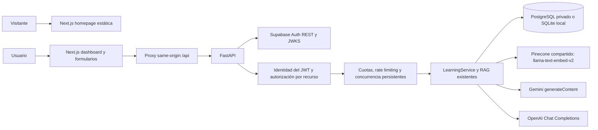

# DevMind — Homepage, autenticación y preparación multiusuario

Verificación realizada el 16/11/2026. El plazo solicitado era el 14/11/2026. El trabajo se ejecutó sobre el repositorio existente, con el RAG, los documentos y el calendario de Active Recall reutilizados.

## Estado de las prioridades

| Prioridad P0 | Estado |
| --- | --- |
| Homepage pública | Implementada y comprobada en Chrome |
| Registro y login | Implementados, con proveedor simulado verificado y conexión hospedada pendiente |
| JWT y rutas privadas | Verificados con firmas ES256 y RS256, errores y CSRF |
| Aislamiento multiusuario | Verificado en HTTP, SQLite, PostgreSQL y RLS |
| Gemini real en chat y Active Recall | Verificado con Gemini 3.1 Flash-Lite y espera de 30 segundos |
| Pruebas de seguridad | Aprobadas en la suite ampliada |

## Funcionalidades implementadas

- Homepage pública en portugués brasileño, responsive, con navegación, CTAs, captura real de Estudio, explicación de RAG y fuentes, flashcards, repetición espaciada, tres pasos, FAQ y footer.
- Homepage prerenderizada, accesible mediante teclado, con enlace para saltar al contenido y soporte de movimiento reducido. Sus visitas generan cero solicitudes a la API del producto.
- Registro, acceso, confirmación por código de email, reenvío, recuperación, actualización de contraseña, renovación y cierre de sesión con Supabase Auth REST.
- Cookies HttpOnly, SameSite=Lax y Secure en producción. El navegador utiliza el proxy same-origin `/api`. El refresh token queda limitado a `/api/auth`.
- Protección de `/dashboard` en el servidor Next.js y autorización de `/ask`, `/learning/*` y `/auth/me` en FastAPI.
- Validación criptográfica ES256/RS256 mediante JWKS, firma, expiración, `iat`, issuer, audience, UUID de `sub`, rol `authenticated` y rechazo de cuentas anónimas. La identidad privada procede del JWT.
- Persistencia por `user_id`, cuotas individuales y globales, rate limiting por IP y usuario, leases de concurrencia y errores públicos sanitizados.
- Abstracción LLM para Gemini nativo y OpenAI. Chat, tarjetas y corrección comparten la generación estructurada, conservando Pydantic, validación de fuentes y abstenciones.
- Estados de carga, errores, sesión expirada y progreso vacío. Los rascunhos usan sessionStorage separado por cuenta. Los cambios de identidad limpian los rascunhos y renuevan el documento del navegador.

## Arquitectura actualizada



Supabase conserva las contraseñas. FastAPI recibe los JWT y gestiona las cookies. Esta elección permite cookies HttpOnly con el frontend existente y centraliza la autorización. La interfaz Next.js consulta `/auth/me` antes de renderizar el dashboard. La sesión expirada se renueva mediante POST y los errores preservan el progreso persistido. Un logout revoca el refresh correspondiente en Supabase. Los access tokens firmados conservan su vigencia hasta expirar, por lo que se recomienda configurar una duración corta en el proveedor. Si la contraseña cambia y falla la revocación global del proveedor, la API limpia las cookies y comunica explícitamente el cambio realizado y la revocación pendiente. [JWT de Supabase](https://supabase.com/docs/guides/auth/jwts), [Sesiones de servidor](https://supabase.com/docs/guides/auth/server-side/advanced-guide)

El corpus actual es compartido. Cada tarjeta conserva su propia evidencia inmutable y su propietario. El producto acepta documentos del catálogo. La incorporación de documentos privados requerirá metadata de propietario, filtro vectorial obligatorio y autorización del catálogo antes de habilitar ese nuevo flujo.

### Decisiones de integración

- Se eligió Supabase Auth REST con cookies administradas en FastAPI. La integración usa la clave publishable en el servidor. La configuración de JWT exige una clave de firma asimétrica. Para proyectos antiguos HS256, la ruta prevista es rotar a ES256/RS256 en Supabase antes de conectar la aplicación.
- PostgreSQL utiliza el schema privado `devmind`, transacciones y un advisory lock corto para escrituras. La llamada externa ocurre fuera de la transacción. La serialización global simplifica las garantías iniciales y será un punto de capacidad a medir al aumentar el tráfico.
- El valor predeterminado es `LLM_PROVIDER=gemini`, con `GEMINI_MODEL=gemini-3.1-flash-lite` y 30 segundos de espera propios para Gemini. Esta combinación pasó el conjunto real con la cuenta configurada. El intento con 3.5 devolvió 503 y 2.5 devolvió 404. El nivel gratuito está publicado y la disponibilidad futura depende del proyecto. OpenAI se selecciona con `LLM_PROVIDER=openai`. [Precios](https://ai.google.dev/gemini-api/docs/pricing)
- Gemini utiliza `generateContent`, `systemInstruction`, `responseJsonSchema`, `finishReason`, filtros de seguridad y `usageMetadata`. OpenAI conserva JSON Schema estricto y sus parámetros propios. Las respuestas se validan localmente y las citas se resuelven desde la evidencia. Los tokens Gemini se registran como consumo Gemini. [API nativa](https://ai.google.dev/api/generate-content), [Salidas estructuradas](https://ai.google.dev/gemini-api/docs/structured-output)
- El primer alcance de registro exige declaración de mayoría de edad, residencia en Brasil y aceptación de términos. `SIGNUP_ENABLED` tiene valor predeterminado falso en producción. La autodeclaración y los formularios requieren medidas operativas adicionales para abrir el servicio al público.

## Migraciones y datos existentes

### SQLite

`001_learning.sql` conserva el esquema histórico. `002_multiuser.sql` renombra las columnas `learner_id` a `user_id` y agrega contadores de seguridad. La actualización automática usa una transacción y `user_version=2`. La cuenta histórica `local-demo` conserva sus datos. Cada UUID autenticado empieza con su propia biblioteca.

### PostgreSQL

`003_postgres.sql` crea el schema privado, las tablas equivalentes, secuencias para desempatar intentos y políticas RLS de propietario. Los roles públicos, `anon` y `authenticated` carecen de acceso al schema. Una conexión del backend establece `app.user_id` en cada transacción.

RLS se aplica a roles sin privilegios de propietario o BYPASSRLS. Para producción, aplique las migraciones con un rol de migración y use un rol de ejecución separado. Conceda a ese rol USAGE en `devmind`, SELECT en `schema_version`, SELECT/INSERT en `learners`, SELECT/INSERT/UPDATE en las tablas de aprendizaje, acceso a sus secuencias y SELECT/INSERT/UPDATE/DELETE en los contadores y leases. Evite conceder membresía de ese rol a roles públicos. Configure TLS verificado en la conexión.

```bash
.venv/bin/python manage_db.py migrate
.venv/bin/python manage_db.py import-sqlite --source data/learning.sqlite3
```

La importación usa SQLite Backup API para obtener una instantánea consistente, migra una copia temporal y escribe todas las entidades en una sola transacción PostgreSQL. Exige un destino vacío para las tablas de aprendizaje. Una segunda importación sobre un destino ocupado se cancela. El SQLite original se preserva.

Para transferir explícitamente el progreso histórico a su propia cuenta confirmada, utilice el UUID de Supabase.

```bash
.venv/bin/python manage_db.py import-sqlite --source data/learning.sqlite3 --owner UUID_DE_SUPABASE
```

Detenga las escrituras del MVP antes del corte final, haga backup, importe y compruebe tarjetas, intentos, sesiones y fechas. Inicie la API con `DATABASE_URL` y compruebe el acceso de dos cuentas. La vuelta al SQLite original recupera el estado del backup. Los nuevos eventos creados después del corte necesitan una reconciliación explícita antes de una vuelta atrás.

## Seguridad y cuotas

| Control | Valor predeterminado |
| --- | --- |
| Chat por usuario y día de São Paulo | 50 |
| Generaciones por usuario y día | 10 |
| Evaluaciones por usuario y día | 50 |
| Operaciones IA globales por día | 200 |
| Tarjetas por generación | 1 a 3 |
| Concurrencia IA por usuario / global | 1 / 4 |
| Solicitudes autenticadas por usuario y minuto | 60 |
| Solicitudes privadas por IP y minuto | 120 |
| Operaciones de acceso por IP y minuto | 10 |

Los valores se configuran en `.env.example`. Un límite diario de cero desactiva la operación. Las reservas son atómicas y persisten entre procesos. Los fallos cuentan en la cuota. El replay de una operación concluida conserva su resultado y su calendario. Los leases vencen de acuerdo con el presupuesto de timeout. Los 429 del proveedor producen un error controlado y una nueva tentativa queda a cargo del usuario.

El backend limita el cuerpo de las solicitudes a 32 KiB, incluyendo envíos fragmentados. Las mutaciones con cookies requieren Origin permitido y `X-DevMind-CSRF: 1`. Los clientes con bearer se autentican con el JWT. El backend ignora cabeceras de IP de peers sin confianza. En un proxy real, configure una cadena de confianza verificable con `TRUSTED_PROXY_CIDRS`, preserve la IP original y compruebe el límite desde dos clientes. La conexión directa al backend debe quedar restringida por la infraestructura.

El registro de consumo guarda modelo, tiempos, tokens medidos y códigos de error. Los cuerpos de proveedores y las claves quedan excluidos de los errores públicos. Los límites por operación acotan el consumo. El presupuesto monetario y las alertas del proveedor deben configurarse en sus paneles antes de publicar.

## Verificación y evidencia

La suite ampliada aprobó **192 pruebas** con **1 integración optativa omitida**, ejecutando también PostgreSQL 18 temporal. Se verificaron firma JWT real, expiración, manipulación, issuer, audience, cuentas anónimas, ausencia de token, CSRF, aislamiento por objeto, intentos, sesiones, replays, persistencia, cuotas concurrentes y RLS con un rol PostgreSQL sin privilegios de propietario.

El aislamiento usa dos UUID distintos. A genera un cartão y registra una respuesta. B recibe 404 al consultar o revisar ese cartão y al autoevaluar el intento de A. Su progreso y su sesión diaria son propios. Reutilizar el request_id de A conserva el alcance de B. Reabrir la base recupera el progreso de A. La importación comprobó un destino temporal, reasignación explícita de propietario, hash del SQLite original y rechazo de una importación repetida.

El validador RAG simulado ejecutó 41 escenarios. El validador Active Recall simulado completó generación, tres evaluaciones, autoevaluación, sesión y recuperación. `ingest.py --dry-run` validó 503 documentos y 3841 fragmentos.

### OpenAI y Pinecone reales

El conjunto pequeño final aprobó un chat con fuentes, una generación y tres evaluaciones. Los resultados fueron `correct`, `incorrect` e `incorrect` para respuesta equivalente, respuesta errónea e intento de cambiar las instrucciones. Se comprobaron replay, calendario, sesión y recuperación tras reabrir la base. El modelo resuelto fue `gpt-4o-2024-08-06`. El conjunto final reportó 2892 tokens de entrada y 552 de salida, 3444 en total. Se retiraron los tres fragmentos del namespace temporal y se comprobó la limpieza.

Dos ejecuciones previas fueron rechazadas de forma controlada. Una evaluación propuso un comando con un marcador ausente de la evidencia. Otra declaró `correct` junto con conceptos faltantes. Se precisaron las instrucciones de copia y consistencia de la rúbrica, conservando los validadores. La ejecución final usó temperatura cero. Los reportes previos se preservaron para revisar la variabilidad del modelo. Las tres ejecuciones sumaron 12 llamadas LLM. El consumo agregado indicado arriba corresponde a las cinco llamadas del conjunto final.

La evidencia completa está en `evaluation/public-openai-live-local.json`, con los dos intentos anteriores en `public-openai-live-first-local.json` y `public-openai-live-second-local.json`. Los nombres `*-local.json` están ignorados por Git. El resumen revisable se encuentra en `evaluation/public-verification-2026-11-16.json`.

### Gemini y Supabase

Gemini 3.1 Flash-Lite completó un chat con fuentes, una tarjeta y tres evaluaciones reales con resultados `correct`, `incorrect` e `incorrect`. Se comprobaron replay, repetición espaciada y persistencia. El consumo reportado fue de 2855 tokens, con 2221 de entrada y 634 de salida. La limpieza del namespace temporal se verificó. El reporte está en `evaluation/public-gemini-31-live-local.json`. Los contratos simulados cubren además timeout, 429, seguridad, truncamiento y citas inválidas.

Los contratos Supabase fueron probados con respuestas de autenticación simuladas y JWT ES256 firmados criptográficamente. La integración hospedada requiere `SUPABASE_URL`, `SUPABASE_PUBLISHABLE_KEY`, proyecto con firma asimétrica, correo configurado y una cuenta confirmada para probar login. La entrega registra el estado externo comprobado en el resumen de verificación.

### Navegador y frontend

El recorrido Chrome usa la API de fixtures explícita y tokens ES256 reales de prueba. Las respuestas de email y de IA están simuladas. Comprueba desktop y móvil emulado, homepage, registro, código, estudio, aislamiento de A/B, logout, recuperación de progreso, renovación de sesión y recuperación de contraseña. Las capturas `public-*.png` quedan en `docs/screenshots`. El resumen de verificación identifica el resultado final de ese recorrido y del build.

## Ejecutar localmente

```bash
uv venv .venv
uv pip install -p .venv/bin/python -r requirements.txt
npm --prefix frontend ci
```

Conserve su `.env` y complete las variables de `.env.example`. Para desarrollo, SQLite puede usarse sin PostgreSQL. Configure Supabase antes de registrar cuentas. En el panel Auth, habilite confirmación de email y firma asimétrica. Configure SMTP y los límites de envío para probar con cuentas reales. [Passwords y confirmación](https://supabase.com/docs/guides/auth/passwords)

### Correos de confirmación y recuperación

La aplicación verifica códigos OTP mediante FastAPI y guarda la sesión en cookies HttpOnly. Prepare los correos del proyecto Supabase antes de probar el registro. En el panel hospedado observado, **Source** permanece deshabilitado con el aviso **Set up custom SMTP to edit the source** hasta configurar SMTP propio.

1. En **Authentication → URL Configuration**, establezca **Site URL** en `http://localhost:3035` para el entorno local. Para producción, use la URL HTTPS del frontend.
2. En **Authentication → Emails**, abra la configuración SMTP. Habilite SMTP propio y complete host, puerto, usuario, contraseña SMTP, email remitente y nombre del remitente con los datos de su proveedor de correo. Guarde la configuración. El proveedor debe autorizar el remitente elegido. [Configurar SMTP](https://supabase.com/docs/guides/auth/auth-smtp)
3. Abra **Templates → Confirm sign up**, seleccione **Source**, reemplace el cuerpo completo por el contenido de [confirm-signup.html](../supabase/templates/confirm-signup.html) y guarde. Puede usar el asunto `Confirme seu email no DevMind`.
4. En **Reset password**, reemplace el cuerpo completo por el contenido de [reset-password.html](../supabase/templates/reset-password.html) y guarde. Puede usar el asunto `Recupere seu acesso ao DevMind`.
5. Solicite un correo nuevo desde **Reenviar código de confirmação** o **Enviar código de recuperação**. El mensaje debe mostrar el código y su enlace debe abrir `/verificar`.

`{{ .Token }}` muestra el código de uso único. Las plantillas enlazan a una página del sitio y el usuario introduce el código allí. Las sesiones se crean en el backend al verificar el código. Para recuperación, marque **Estou recuperando minha senha** antes de confirmar. Los mensajes emitidos previamente conservan su contenido original. [Plantillas oficiales y OTP](https://supabase.com/docs/guides/auth/auth-email-templates)

El enlace predeterminado de Supabase puede devolver una sesión en el fragmento `#access_token=…`. Ese fragmento queda accesible al navegador y a JavaScript de la página de destino. Trátelo como una credencial al compartir URLs o capturas. Si ya se activó el enlace de registro y la redirección falló en el puerto 3000, abra `/entrar` en el puerto 3035 e intente acceder con su email y contraseña. [Flujo implícito](https://supabase.com/docs/guides/auth/sessions/implicit-flow), [URL de redirección](https://supabase.com/docs/guides/auth/redirect-urls)

```bash
.venv/bin/python -m uvicorn api:app --host 127.0.0.1 --port 8000 --no-proxy-headers
npm --prefix frontend run dev
```

Abra `http://localhost:3035`. El frontend utiliza `API_URL` en `frontend/.env.local`, con valor predeterminado `http://127.0.0.1:8000`. Configure esa variable al compilar y ejecutar un build de producción.

```bash
npm --prefix frontend run build -- --webpack
npm --prefix frontend run start -- --hostname 127.0.0.1 --port 3035
```

Para PostgreSQL, configure `DATABASE_URL`, aplique `manage_db.py migrate` y ejecute la API. En `APP_ENV=production`, las rutas privadas exigen PostgreSQL y las cookies usan Secure, por lo que el navegador necesita HTTPS.

### Reproducir pruebas

```bash
.venv/bin/python -m pytest tests/ -q
.venv/bin/python ingest.py --dry-run
.venv/bin/python evaluation/evaluate.py
.venv/bin/python evaluation/validate_learning.py
npm --prefix frontend run lint
(cd frontend && npx --no-install tsc --noEmit)
npm --prefix frontend run build -- --webpack
```

Para incluir PostgreSQL, exporte `TEST_DATABASE_URL` apuntando a una base exclusiva de pruebas y ejecute pytest. Esa suite crea datos de prueba y una base temporal para verificar la importación. Para Supabase hospedado, configure una cuenta confirmada en `DEVMIND_TEST_EMAIL` y `DEVMIND_TEST_PASSWORD` y ejecute `.venv/bin/python evaluation/validate_auth.py --live`. El script comprueba login, JWT, cookies, renovación y logout con persistencia temporal. La entrega del email se verifica por separado en su bandeja de pruebas.

Para proveedores reales, seleccione `LLM_PROVIDER` y ejecute el conjunto pequeño.

```bash
.venv/bin/python evaluation/validate_learning.py --live
```

Para Chrome, inicie `evaluation/serve_learning_fixture.py --mock --port 8007`, compile con `API_URL=http://127.0.0.1:8007`, ejecute Next en 3036 con la misma variable y lance `node frontend/tests/public.e2e.mjs`. `PLAYWRIGHT_MODULE_PATH` permite usar una instalación existente. El servidor de fixtures utiliza exclusivamente loopback y datos temporales.

## Límites de lanzamiento y condiciones oficiales

Gemini exige 18 años y restringe clientes dirigidos o probablemente accesibles a menores. Sus términos describen uso profesional o comercial. El servicio gratuito puede usar entradas y salidas para mejora y revisión humana, y excluye información sensible. EEE, Suiza y Reino Unido requieren servicios pagos. Este producto educativo abierto exige resolver la compatibilidad del público previsto y la aplicación de restricciones antes del lanzamiento. [Términos Gemini](https://ai.google.dev/gemini-api/terms)

Brasil aparece entre las regiones disponibles. La declaración de residencia de un formulario exige controles operativos para limitar el acceso efectivo y contemplar usuarios que viajan. El acceso real del proyecto y sus cuotas deben verificarse en la cuenta. [Regiones](https://ai.google.dev/gemini-api/docs/available-regions)

El corpus heredado requiere revisión de licencia antes de su distribución. La política de privacidad necesita responsable, canal de contacto, retención de backups y procedimiento de exclusión. La autodeclaración de edad y residencia requiere validación adicional antes de admitir registros públicos. El calendario determinista está probado. La calidad pedagógica requiere más respuestas humanas etiquetadas y preguntas reservadas.

## Checklist para apertura pública

- [x] Completar y aprobar Gemini real con la cuenta configurada usando 3.1 Flash-Lite y espera de 30 segundos.
- [ ] Completar registro, correo, login, renovación y recuperación con Supabase hospedado.
- [ ] Validar PostgreSQL administrado, TLS, backups, restauración y rol de ejecución con privilegios mínimos.
- [ ] Revisar compatibilidad del público con los términos de Gemini y aplicar restricciones de edad y región.
- [ ] Revisar licencias del corpus y publicar el catálogo autorizado.
- [ ] Publicar responsable, contacto, retención y procedimiento de exclusión de datos.
- [ ] Configurar HTTPS, dominio, CORS, proxy confiable, tamaño máximo de solicitud y límites de borde.
- [ ] Configurar presupuesto, alertas y cuotas en los proveedores y medir concurrencia con carga real.
- [ ] Repetir Chrome con servicios hospedados y correo real.
- [ ] Habilitar `SIGNUP_ENABLED=true` al aprobar las condiciones de apertura.

## Archivos de esta fase

| Área | Archivos |
| --- | --- |
| Autenticación y protección | `auth.py`, `security.py`, `api.py`, `learning_api.py` |
| LLM y RAG | `llm.py`, `config.py`, `rag.py`, `learning_service.py` |
| Persistencia y migración | `learning_store.py`, `database.py`, `manage_db.py`, `migrations/002_multiuser.sql`, `migrations/003_postgres.sql` |
| Homepage | `frontend/app/page.tsx`, `frontend/app/layout.tsx`, `frontend/app/globals.css`, `frontend/public/previews/study-multiuser.png` |
| Cuenta y dashboard | `frontend/components/auth/AuthForm.tsx`, `frontend/components/auth/Session.tsx`, páginas `/cadastro`, `/entrar`, `/verificar`, `/recuperar`, `/nova-senha`, `/dashboard` y sus estados de carga/error |
| Cliente y proxy | `frontend/lib/api.ts`, `frontend/next.config.ts`, `frontend/components/study/Study.tsx` |
| Privacidad y términos | `frontend/app/privacidade/page.tsx`, `frontend/app/termos/page.tsx` |
| Pruebas | `tests/test_security.py`, `tests/test_gemini.py`, `tests/test_postgres.py`, `tests/conftest.py`, ajustes de `test_api.py` y `test_learning.py` |
| Validadores y Chrome | `evaluation/evaluate.py`, `evaluation/validate_learning.py`, `evaluation/validate_live.py`, `evaluation/serve_learning_fixture.py`, `evaluation/validate_auth.py`, `frontend/tests/public.e2e.mjs`, `frontend/tests/study.e2e.mjs` |
| Configuración y documentación | `.env.example`, `frontend/.env.example`, `requirements.txt`, `README.md`, `frontend/README.md`, `docs/ARCHITECTURE.md`, `docs/ACTIVE_RECALL.md`, `docs/DECISIONS.md`, este informe y evidencia de verificación |

## Texto para CV ATS

Desenvolvi o DevMind, assistente de estudos com IA usando Next.js, TypeScript e Python/FastAPI, integrando RAG com Pinecone, flashcards fundamentados e repetição espaçada. Implementei Supabase Auth/JWT, isolamento multiusuário em PostgreSQL com RLS, abstração Gemini/OpenAI e cotas de consumo. Validei segurança e persistência com 192 testes e o pipeline com OpenAI e Pinecone reais.
